# Краткие итоги

- **Главный вывод (§7).** RL почти не нужен как способ обучения, но награда из RM полезна. Лучше всего её реализует переранжирование (точный оптимум той же цели) или его дистилляция в одну модель. RL оправдан, когда награда зависит от всего списка или от многошаговой сессии и закрытого оптимума нет.
- **Протокол.** GPT-2 [1] (4 слоя, 256 измерений, контекст 256 прослушиваний, словарь 200 тыс. треков) обучена на next-item prediction на Yambda-50M [2]. Разбиение глобальное по времени: train | 30 мин | val-день | 30 мин | test-день. Все статистики считаются только на train.
- **Базовая модель исправна.** Она заметно сильнее SASRec [3] из статьи Yambda (paper NDCG@10 0.128 против 0.075), но уступает эвристике Repeat (0.135). В этих данных доминируют повторы: 84% top-10 базовой модели — уже прослушанные треки.
- **Reward model.** Модель отклика предсказывает долю прослушивания, Listen+, скип и лайк заметно лучше бейзлайнов по пользователю и треку (Spearman по ratio 0.66 против 0.46, AUC Listen+ 0.89 против 0.77). Головы `dislike` и `continue` почти не лучше среднего по пользователю. Для честной оценки обучены две RM: proxy (награда для RL) и gold (только для оценки).
- **RL максимизирует награду, но в основном через «дешёвые» пути.** При росте KL к исходной политике выдача укорачивается (207 → 165 с), теряет повторы и концентрируется на меньшем наборе треков (coverage@10 0.115 → 0.05). NDCG@10 монотонно падает: 0.127 → 0.08 при KL 4. Gold RM переоптимизации не показывает, так что компромисс проходит между «удовлетворённостью по RM» и поведенческой релевантностью, а не между proxy и gold.
- **Методы (RLOO [4], GRPO [5], BoN, онлайн-DPO [6]) при равном KL неразличимы.** Разница «при одном β» объясняется только масштабом регуляризации.
- **Лучший компромисс даёт переранжирование.** Аналитический оптимум той же цели, π_ref·exp(r/β) по top-100 π_ref, значимо повышает NDCG@10 на 6% (val 0.127 → 0.135, test 0.122 → 0.130, p < 0.001) при KL ≤ 0.1 и одновременно поднимает gold-награду. RL — неполная амортизация этого оптимума. Лучшая RL-политика (RLOO, KL 0.14) даёт лишь +2% NDCG, и после поправки на множественные сравнения этот прирост значим только на test. Это согласуется с GPTRec (Petrov & Macdonald, 2024) [7]: RL с наградой за точность даёт малый и статистически ненадёжный прирост.
- **Дистилляция реранкера в одну модель** (CE к целевому распределению без сэмплирования) лучше RLOO при вдвое меньшем KL: +3–4% NDCG@10 и рост Recall@100. Значит, заметная часть разрыва RL — шум оценки градиента по 16 сэмплам.
- **Варианты награды.** Время прослушивания взламывается длиной (494 с в top-10). Награда за лайк переоптимизирует слабую голову RM. Нормировка ratio по длине трека (R4) убирает смещение к коротким трекам без потери релевантности. Штрафы за повторы, дизлайк и неопределённость не помогают.
- **Больший бюджет дистилляции разрыв не закрывает.** 10 тыс. шагов или lr 2e-4 поднимают proxy-награду, но не NDCG; при том же KL, что у реранкера, политика на 0.006 NDCG хуже. Остаток разрыва — предел ёмкости и обобщения одной модели, а не недообучение.
- **Разнообразие и популярность.** Штраф за повтор артиста в реранкере даёт +1.6–2 разных артиста в top-10 ценой −0.018…−0.03 NDCG; RL при том же NDCG — лишь +0.6–1.1 артиста и попутно сдвигается к популярным трекам. Штраф за популярность в реранкере (β = 0.1) вдвое снижает среднюю популярность выдачи без потери NDCG относительно π_ref.
- **Листовое разнообразие.** Жадная сборка слейта (реранкер плюс бонус за нового артиста на позициях 1–10) даёт +1.3 артиста в top-10 ценой всего −0.0013 NDCG к реранкеру и остаётся на +5% выше π_ref. Поточечный штраф за артиста стоит в 10 раз дороже. RL с наградой за список (Plackett–Luce) получает разнообразие дешевле поточечного RL, но жадный слейт не догоняет: при том же λ у слейта на 1.3 артиста больше, выше gold и не ниже NDCG. Для ручной субмодулярной листовой цели обучение не нужно.
- **Выученная RM слейта.** RM, обученная на реальных сериях рекомендаций и предсказывающая отклик на позицию с учётом предыдущих треков списка, лучше поточечной (loss −3.5%, AUC Listen+ +0.009), и выигрыш растёт к концу серии. Но списки она ранжирует почти так же (Spearman награды списка с реальным ratio 0.737 против 0.734). Единственный сильный листовой эффект в логах — повтор артиста внутри серии (ratio 0.43–0.61 против 0.73), и он редок. RL с Next-K генерацией против этой RM поднимает gold-награду списка (+0.017 при KL 0.5 без потери NDCG, +0.056 ценой −0.015 NDCG), и gold идёт за proxy без переоптимизации. Но пошаговый поиск по той же RM без обучения доминирует RL по обеим осям (+0.031 gold и +0.008 NDCG к π_ref), а поточечный реранкер не уступает листовому RL даже по листовой награде (§5.7).
- **Off-policy REINFORCE на логах** (Matveev et al., 2026) [8] учит политику подражать залогированному рекомендателю: KL ≈ 1, NDCG@10 ниже на 19–26%, при этом многошаговая IS-коррекция ничего не меняет (K = 10 ≈ K = 0). Офлайн-оценки IS здесь неинформативны (эффективный размер выборки ≈ 0).
- **Новизна.** В режиме без повторов ни одна политика не лучше исходной: новые треки, которые продвигает RM, не чаще оказываются релевантными.
- **Долгосрочные прокси.** Голова `continue` (следующее прослушивание в пределах 30 мин) почти целиком пользовательская: внутри пользователя её связь с длиной оставшейся сессии ≈ 0.03 (в минутах ≈ 0), а возвращение на следующий день не предсказывает ни одна голова RM (AUC ≈ 0.5 против 0.67 у числа прослушиваний за день). Оптимизация R6 = p(continue) поднимает и gold p(continue), но через короткие и популярные треки и ценой −0.013…−0.05 NDCG@10. Это R1 с более слабой меткой, а не долгосрочная цель.
- **Генерация на несколько шагов.** При жадной генерации все политики, включая π_ref, за 2–3 шага сваливаются в повтор одного трека (95–100% к шагу 5). Сэмплирование убирает петли у политик рядом с π_ref, но не у схлопнувшейся GRPO. NDCG падает с шагом на 10–30% у всех, порядок политик сохраняется, KL к π_ref не накапливается. Обе RM оценивают петлю выше реальных сессий и с меньшей неопределённостью, так что симулятор на них поощрял бы зацикливание.

# 1. Постановка задачи и данные

## 1.1. Задача

Пользователь — последовательность прослушиваний s₁ → … → s_t. Базовая модель π_ref(a | s_{≤t}) предсказывает следующий трек. Требуется дообучить её с RL так, чтобы рекомендации получали более высокое ожидаемое вознаграждение r̂(s, a) по модели отклика, и изучить, что при этом происходит с поведением модели и релевантностью. Общая цель RL-дообучения, как в RLHF:

$$\max_\pi \; \mathbb{E}_{s}\,\mathbb{E}_{a\sim\pi(\cdot|s)}\big[r(s,a)\big] - \beta\,\mathrm{KL}\big(\pi(\cdot|s)\,\|\,\pi_\text{ref}(\cdot|s)\big).$$

Её оптимум известен в явном виде: π*(a|s) ∝ π_ref(a|s)·exp(r(s,a)/β). Это используется дальше как бейзлайн «переранжирование» (§4.3).

## 1.2. Данные: Yambda-50M

Yambda [2] — открытый датасет Яндекс Музыки. Используется версия 50M: 10 тыс. пользователей ([карточка датасета](https://huggingface.co/datasets/yandex/yambda)), 46 млн прослушиваний в train, а также лайки и дизлайки. У каждого прослушивания есть доля прослушивания (`played_ratio_pct`), длина трека и флаг `is_organic`: 0 — рекомендация, 1 — библиотека или поиск. Треки, артисты и альбомы обезличены, названий нет.

Основные факты из EDA (`notebooks/01_eda.ipynb`, только train):

- **Доля прослушивания бимодальна.** 53% прослушиваний полные, 24% — скипы (≤ 5%). Listen+ (доля ≥ 50%) составляет 63%.
- **Доля прослушивания падает с длиной трека:** с 73% у треков до 60 с до 48% у треков длиннее 10 мин. Время прослушивания при этом растёт. Награда за долю выгодна коротким трекам, награда за время — длинным. Это главная ось взлома награды.
- **Повторы дослушиваются лучше**, чем первые прослушивания (+4–9 п.п.). Награда за долю поощряет повторы.
- **Сессии** (пауза 30 мин): медиана — 10 прослушиваний и 23 мин. Пользователи регулярны: за 74% активных дней следует активный следующий день.
- **Длинный хвост.** Словарь из 200 тыс. самых популярных треков покрывает 95% прослушиваний train и 91% Listen+-таргетов test.

## 1.3. Протокол оценки и защита от утечек

- **Global Temporal Split**, как в бенчмарках Yambda: train | 30 мин | val (1 день) | 30 мин | test (последний день). Модель замораживается на начале периода: контекст для val — события до `train_end`, для test — до `val_end`. В val/test остаются только пользователи train: 4628 и 4600 пользователей.
- **Только train:** словарь, популярность, средние доли по трекам и по бинам длины, обучение RM, контексты RL. Гиперпараметры (β, шаг, метод) выбираются по val; test используется для подтверждения.
- **Признаки RM для события t** берутся только из событий < t. Используются состояние энкодера на t−1 и признаки кандидата, известные на момент рекомендации. Метки ограничены тем, что наблюдалось до границы периода.
- **Таргет релевантности** — Listen+ треки дня. Метрики: Recall@K, NDCG@K, MAP@K для K ∈ {10, 100} в формулах `metrics.relevance_metrics`. Формулы статьи Yambda (`paper_*`) используются только для сверки с SASRec.
- **Фильтр уже прослушанного** (`exclude_seen`) — отдельный режим оценки, а не скрытая постобработка.
- **Значимость:** парный бутстреп [9] по пользователям (10 000 ресэмплов, общих для всех сравнений), 95% CI и двусторонний p. Поправка на множественные сравнения — Holm [10] (p_holm) по всем парам таблицы для каждой метрики, дня и режима (Petrov & Macdonald, 2024 [7] используют Bonferroni; Holm контролирует ту же FWER и мощнее). Все выводы проверяются на двух независимых днях (val и test).

# 2. Базовая модель (π_ref)

**Архитектура.** GPT-2: 4 слоя, 4 головы, d = 256, контекст 256 прослушиваний. Вход на позиции t — эмбеддинг трека плюс эмбеддинги отклика на него: бин доли прослушивания, бин длины, `is_organic`, лайк и дизлайк (без утечек, по времени). Модель предсказывает следующий трек по словарю из 200 тыс. треков. Обучение: sampled softmax с поправкой logQ [11], 8 эпох, lr 1e-3, батч 128.

| Метод | val NDCG@10 | val Recall@100 | test NDCG@10 | test Recall@100 | coverage@10 |
|---|---|---|---|---|---|
| MostPop | 0.024 | 0.052 | 0.023 | 0.056 | 0.00005 |
| Repeat (недавние разные треки пользователя) | **0.135** | **0.275** | **0.133** | **0.272** | 0.136 |
| GPT-2 (π_ref) | 0.127 | 0.228 | 0.122 | 0.224 | 0.115 |
| GPT-2 без признаков отклика | −0.004 к π_ref | | −0.004 | | |
| GPT-2, `exclude_seen` | 0.024 | 0.045 | 0.024 | 0.044 | 0.108 |

- **Пайплайн исправен:** в формулах статьи NDCG@10 = 0.128 против 0.075 у SASRec. Val и test согласуются.
- **Повторы доминируют.** Эвристика Repeat сильнее модели. 84% top-10 π_ref — уже прослушанные треки, 9% — новые треки знакомых артистов, 7% — новые артисты. Смещения к популярному у π_ref нет: медианный ранг популярности её выдачи (≈10 тыс.) такой же, как у Repeat.
- **В роли π_ref взята модель, обученная на всех действиях**, а не только на Listen+. Так прирост «π_ref → RL» показывает вклад именно RL. Вариант, обученный на Listen+, догоняет Repeat (0.135), но он уже частично выровнен под награду.

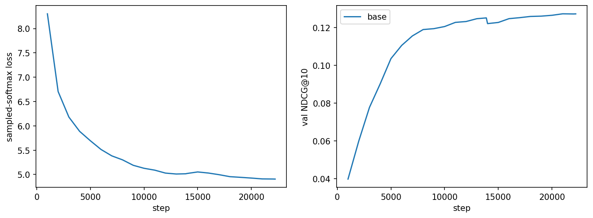{width=80%}

# 3. Модель вознаграждения

## 3.1. Устройство

RM предсказывает отклик на трек-кандидат после истории (`reward_model.py`). Энкодер — та же GPT-2, инициализированная базовой моделью; её состояние h_{t−1} описывает историю. Кандидат представлен эмбеддингом трека и признаками, известными на момент рекомендации: бин длины, `is_organic`, число повторов в контексте. Головы (MLP на [h, c, h·c]):

| Голова | Таргет |
|---|---|
| `ratio` | min(доля, 100%)/100, soft BCE |
| `listen_plus`, `skip` | доля ≥ 50% / < 30% |
| `like`, `dislike` | реакция, привязанная к прослушиванию |
| `continue` | следующее прослушивание начинается в пределах 30 мин |

Поздняя фьюжн-схема оценивает G кандидатов одного контекста за один проход трансформера. Это нужно для RL (16 сэмплов на контекст) и для переранжирования (100 кандидатов). Неопределённость оценивается ансамблем из 4 голов с бутстреп-весами.

**Две RM.** Proxy RM даёт награду для RL. Gold RM используется только для оценки и отличается сидом, случайной инициализацией, подвыборкой 80% пользователей и аудиоэмбеддингами. Это защищает от самой грубой переоптимизации [12], но не от общих смещений данных: обе модели учились на одних логах.

## 3.2. Качество (val, 202 тыс. прослушиваний)

| Голова | proxy | gold | Лучший бейзлайн (train-средние) |
|---|---|---|---|
| ratio: MAE / Spearman | 0.218 / 0.656 | 0.221 / 0.653 | 0.306 / 0.460 (пользователь + трек) |
| Listen+: AUC | 0.886 | 0.884 | 0.772 |
| skip: AUC | 0.887 | 0.884 | 0.767 |
| like: AUC / PR-AUC | 0.883 / 0.101 | 0.880 / 0.081 | 0.817 / 0.034 (пользователь) |
| dislike: AUC / PR-AUC | 0.807 / 0.021 | 0.791 / 0.017 | 0.811 / 0.011 |
| continue: AUC | 0.641 | 0.638 | 0.631 (пользователь) |

- **Основные сигналы предсказываются хорошо, и калибровка отличная** (ECE ratio ≈ 0.006). Головы `dislike` и `continue` практически не лучше среднего по пользователю, поэтому награды на их основе шумные.
- **Proxy и gold почти совпадают на реальных событиях** (Spearman 0.98 по ratio), **но расходятся в топе каталога.** У proxy в top-100 каталога 4.7% треков из контекста (у gold 0.3%), и proxy заметнее предпочитает популярные треки. Обе модели предпочитают короткие треки: средняя длина в top-100 168 и 151 с против 226 с по каталогу.
- **Чувствительность.** Предсказанный ratio монотонно падает с длиной трека (0.70 → 0.64) и растёт с числом повторов в контексте (0.67 → 0.70). Это и есть дешёвые пути, которые может найти RL.

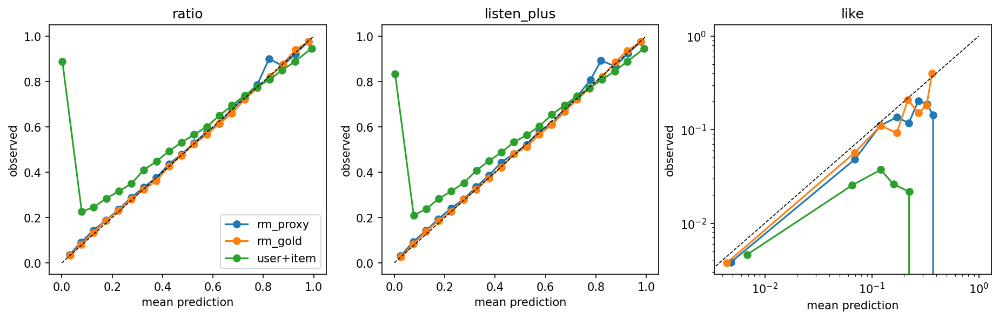{width=90%}

# 4. RL-дообучение

## 4.1. Общая схема

Политика инициализируется π_ref. Контексты — окна из train, обрезанные перед прослушиваниями-рекомендациями. На шаге берутся 64 контекста; из softmax политики по всему словарю сэмплируются G = 16 треков; proxy RM оценивает каждый. Лосс — policy gradient (REINFORCE [13]) плюс β·KL(π_θ‖π_ref), где KL посчитан точно по словарю, а не по сэмплам. Обучение идёт 3000 шагов, lr 5e-5. Каждые 250 шагов (в начале каждые 50) политика оценивается на val-дне: релевантность, proxy и gold награда top-10, состав выдачи, KL. Цикл написан с нуля (`rl.py`), без TRL.

## 4.2. Методы

| Метод | Сигнал на тех же G сэмплах |
|---|---|
| **RLOO** [4] | advantage = r − среднее остальных сэмплов группы |
| **GRPO** [5] | advantage = (r − среднее группы) / std группы (или батча) |
| **Best-of-N** | CE на лучший сэмпл по RM |
| **Онлайн-DPO** [6] | DPO-лосс на паре «лучший — худший сэмпл»; β — параметр DPO |
| **`distill`** | CE к распределению реранкера π_β по top-100 π_ref, без сэмплирования |
| **`exact`** | β·KL(π_θ‖π_β): цель RLOO с точным матожиданием по top-100 |
| **`slate`** | G списков по 10 треков без возвращения (Plackett–Luce [14] из того же softmax); награда списка — средняя RM-награда + λ·(разные артисты)/10; RLOO по спискам |
| **`nextk`** | G списков, каждый трек выбирается с учётом уже выбранных (Next-K); награда — выученная RM слейта; RLOO по спискам, KL к Next-K π_ref по позициям (§5.7) |
| **Off-policy REINFORCE** | залогированные рекомендации с реальной наградой, многошаговая IS-коррекция (Matveev et al., 2026) [8] |

PPO [15] с критиком и GAE [16], как в GPTRec (Petrov & Macdonald, 2024) [7], не используется. Там награда листовая и отложенная (метрика всего списка из K позиций), и критик оценивает ценность частично построенного списка. У нас награда одношаговая: G сэмплов на контекст дают baseline без отдельной модели ценности (RLOO), а точный KL заменяет clipping как ограничитель шага. В `slate` и `nextk` награда листовая, но тоже вычисляется сразу для готового списка, поэтому и там хватает RLOO по спискам.

## 4.3. Бейзлайн: переранжирование

π_β ∝ π_ref·exp((r − r̄)/β) по top-100 π_ref, где r — proxy-награда каждого кандидата в данном контексте (`rerank.py`). Это решение той же регуляризованной цели в явном виде [6], но ограниченное top-100 и требующее вызова RM на инференсе. KL к π_ref считается точно. β = ∞ даёт π_ref, β = 0 — жадную сортировку по награде.

## 4.4. Варианты награды

| ID | Награда | Что поощряет | Ожидаемый взлом |
|---|---|---|---|
| R1 | E[ratio] | дослушивание | короткие треки, повторы |
| R2 | E[ratio]·min(длина, cap) | время прослушивания | длинные треки |
| R3 | p(like) + ratio/10 (как в Matveev et al. [8]) | явное удовлетворение | слабая голова like |
| R4 | E[ratio] − train-средний ratio бина длины | «лучше ожидаемого для такой длины» | — |
| R4' | E[ratio] − train-средний ratio трека | то же по треку | шум на редких треках |
| R5 | R1 − штрафы: повтор, p(dislike), std ансамбля, популярность, повтор артиста | новизна, безопасность, разнообразие | падение релевантности |
| R6 | p(continue) | продолжение сессии | короткие и популярные треки (§5.3) |

Чтобы сравнивать награды при сопоставимом KL, β и веса штрафов задаются в единицах внутригрупповой std награды под сэмплами π_ref (`reward_scales.csv`). KL оптимума зависит от награды только через σ/β. Для R1 σ ≈ 0.043, поэтому β = 0.1 даёт KL ≈ σ²/(2β²) ≈ 0.1.

# 5. Результаты и ответы на вопросы исследования

## 5.1. Вопрос 1. Как меняется поведение модели после RL?

**Награда максимизируется.** Proxy ratio top-10 растёт с 0.695 до 0.715 (RLOO, β = 0.1, KL 0.14) и до 0.756 (β = 0.005, KL 4). Gold ratio растёт синхронно, примерно на 80% от прироста proxy, без перелома вплоть до KL 7.5.

| Политика (val) | KL | NDCG@10 | proxy ratio | gold ratio | Длина, с | Повторы@10 | coverage@10 | Энтропия |
|---|---|---|---|---|---|---|---|---|
| π_ref | 0 | 0.127 | 0.695 | 0.665 | 207 | 0.84 | 0.115 | 6.5 |
| RLOO R1 β = 0.1 | 0.14 | 0.129 | 0.715 | 0.678 | 196 | 0.85 | 0.115 | 5.9 |
| RLOO R1 β = 0.05 | 0.41 | 0.128 | 0.726 | 0.685 | 191 | 0.84 | 0.113 | 5.5 |
| RLOO R1 β = 0.02 | 1.29 | 0.118 | 0.743 | 0.696 | 181 | 0.79 | 0.103 | 4.7 |
| RLOO R1 β = 0.005 | 4.0 | 0.086 | 0.756 | 0.712 | 166 | 0.63 | 0.075 | 3.4 |
| GRPO R1 β = 0.1 | 6.1 | 0.074 | 0.756 | 0.714 | 164 | 0.52 | 0.062 | 2.0 |
| RLOO R4 β = 0.005 | 4.9 | 0.078 | 0.736 | 0.690 | 247 | 0.54 | 0.071 | 2.8 |

**Чем отличаются рекомендации.**

- **Короче.** Это главный путь взлома R1: доля прослушивания падает с длиной трека и в данных, и в RM. R4 разворачивает этот сдвиг: при росте KL длина растёт до 247 с.
- **Меньше повторов, вопреки ожиданию.** Proxy RM в среднем ставит новым коротким трекам награду выше, чем повторам. Доля повторов падает с 0.84 до 0.5.
- **Концентрированнее.** Энтропия падает с 6.5 до 2. Coverage@10 падает с 0.115 до 0.05, Gini@10 растёт с 0.935 до 0.985. Популярность выдачи при этом не растёт (log10 числа прослушиваний 2.85 → 2.6–2.8): политика стягивается к своему набору коротких треков, а не к хитам.
- **Меньше лайков.** Все методы немного снижают gold P(like), на 3–6%, значимо. Оптимизация ratio уводит выдачу от «любимых» треков.

**Объяснение.** Политика ищет то, что RM оценивает выше всего при любом контексте, то есть глобальные сдвиги: длину и новизну. Переставлять кандидатов внутри конкретного контекста она почти не учится (§5.2, §5.5). Все методы policy gradient на сэмплах ведут себя одинаково, если сравнивать их при равном KL: при β = 0.1 GRPO, BoN и DPO ушли на KL 5–7 только потому, что их эффективная регуляризация на два порядка слабее (GRPO делит advantage на σ ≈ 0.04).

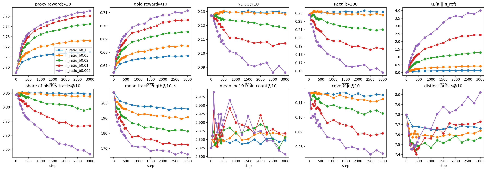{width=100%}

## 5.2. Вопрос 2. Сохраняется ли релевантность?

**Почти нет, кроме малого KL.** NDCG@10 монотонно падает с KL (корреляция с log(1+KL) −0.95): ≈0.127 до KL 0.3, 0.12 при KL 1, 0.08 при KL 4.

Парный бутстреп, NDCG@10, разница с π_ref (val / test); p — без поправки, p_holm — с поправкой Holm по 20 (`distill`: 14) парам таблицы:

| Политика | val: разница, p / p_holm | test: разница, p / p_holm |
|---|---|---|
| RLOO R1 β = 0.1 (KL 0.14) | +0.0020, 0.02 / 0.23 | +0.0028, 0.003 / 0.03 |
| RLOO R1 β = 0.05 | +0.0005, 0.65 / 1 | −0.0004, 0.78 / 1 |
| RLOO R1 β = 0.02 | −0.0093, < 0.001 / 0.004 | −0.0086, < 0.001 / 0.004 |
| `distill` R1 β = 0.05 | +0.0047, < 0.001 / 0.003 | +0.0049, < 0.001 / 0.003 |
| Реранкер R1 β = 0.1 | **+0.0071**, < 0.001 / 0.004 | **+0.0080**, < 0.001 / 0.004 |
| Реранкер R1 β = 0.1 − Repeat | −0.0006, 0.83 / 1 | −0.0033, 0.27 / 1 |

Прирост реранкера и `distill` устойчив к поправке на обоих днях; прирост RLOO β = 0.1 после поправки остаётся только на test. p = 0.0002 — нижняя граница бутстрепа с 10 000 ресэмплами, поэтому p_holm у самых сильных эффектов равен 20 · 0.0002 = 0.004 (у `distill` 14 · 0.0002 ≈ 0.003).

- **Падение NDCG тесно связано с уходом от повторов** (корреляция с долей повторов в top-10 по всем точкам 0.99): Listen+ в этих данных — в основном повторы. Но это не вся причина. При одинаковой proxy-награде и одинаковой доле повторов реранкер на 0.0165 NDCG выше RL при вчетверо меньшем KL (§5.5).
- **Режим без повторов (`exclude_seen`)** проверяет, не теряет ли RL только «лёгкие» повторы, находя взамен хорошие новые треки. Нет: NDCG на новых треках тоже падает с KL (0.024 → 0.012), лучшие политики равны π_ref. Новые треки, которые RM ставит высоко, не чаще оказываются в Listen+.
- **Одни и те же объекты всем.** При KL ≥ 4 coverage@10 падает вдвое, Gini растёт до 0.98–0.99: политика рекомендует всем пользователям меньший набор треков. При рабочих KL ≤ 0.4 coverage не меняется (0.113–0.118), у реранкера тоже (0.114–0.117).

## 5.3. Вопрос 3. Можно ли приблизиться к долгосрочным целям?

**Сигналы в Yambda, пригодные как прокси долгосрочной цели:**

- продолжение сессии после трека: следующее прослушивание в пределах 30 мин, голова `continue` и награда R6;
- длина оставшейся сессии в прослушиваниях и минутах;
- возвращение: активность на следующий день, интервал до следующей сессии;
- последующие органические действия: лайк, прослушивание артиста из библиотеки;
- негативные сигналы: ранний скип, дизлайк, конец сессии сразу после трека.

**Что проверено офлайн.** Модуль `longterm.py`, раздел 6.2 `05_analysis.ipynb`, результаты в `results/stage6/longterm_*`. Предсказания RM на реальных прослушиваниях val- и test-дня (≈ 200 тыс. на день) сопоставлены с исходами из логов: меткой `continue`, числом оставшихся прослушиваний сессии и минутами до её конца (сессии, которые могут продолжаться за границей периода, исключены), а для val — с возвращением пользователя на test-день. Ключевая метрика — корреляция *внутри пользователя* (обе стороны минус среднее пользователя): при фиксированном контексте политика меняет только её, и сигнал, отличающий активных пользователей от неактивных, наградой служить не может.

| Предиктор (val) | continue: AUC | Ост. прослушивания: Spearman / внутри польз. | Ост. минуты: Spearman / внутри польз. |
|---|---|---|---|
| proxy, голова `continue` | 0.641 | 0.30 / 0.036 | 0.12 / −0.003 |
| gold, голова `continue` | 0.638 | 0.28 / 0.025 | 0.10 / −0.011 |
| proxy, голова `ratio` | 0.498 | 0.00 / −0.045 | 0.26 / −0.003 |
| среднее `continue` пользователя (train) | 0.631 | 0.35 / — | 0.22 / — |

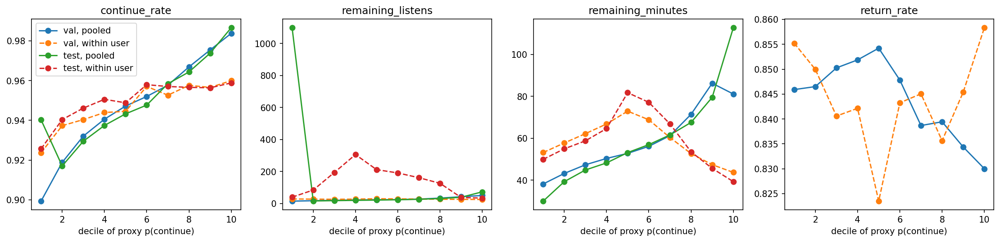{width=100%}

- **Сигнал почти целиком пользовательский.** По всем событиям p(continue) связан с длиной оставшейся сессии, но среднее пользователя связано сильнее (Spearman 0.35 против 0.30 на val, 0.40 против 0.15 на test). На test голова `continue` вообще хуже среднего пользователя (AUC 0.609 против 0.647).
- **Внутри пользователя связи почти нет.** Корреляция с меткой 0.05, с числом оставшихся прослушиваний 0.03–0.04, с оставшимися минутами ≈ 0. От первого до последнего внутрипользовательского дециля доля продолжений растёт лишь с 0.92 до 0.96, число оставшихся прослушиваний не растёт (28 → 25), а оставшиеся минуты в верхних децилях даже падают (73 → 44 мин). Выбор треков с более высоким предсказанным `continue` для данного пользователя не связан с более долгой сессией, в лучшем случае — с большим числом более коротких прослушиваний.
- **Возвращение на следующий день не предсказывается.** AUC среднего предсказания пользователя за день — 0.49–0.52 у всех голов обеих RM, тогда как простое число прослушиваний за день даёт 0.67.
- **Конфаундер длины есть, но слабее ожидаемого.** `continue` отсчитывается от начала прослушивания, поэтому доля продолжений падает с длиной: 0.956 у самых коротких треков, 0.928 у самых длинных (val); RM это воспроизводит (0.956 → 0.934). В абсолютных числах разница мала, но она сопоставима со всем внутрипользовательским размахом сигнала, поэтому длина — самый дешёвый путь поднять R6.
- **Аномалия test-дня.** ≈ 20 тыс. test-прослушиваний (в основном самых длинных треков) принадлежат сессиям из тысяч прослушиваний, и RM сильно недооценивает для них `continue` (0.79 при фактических 0.97). Похоже на непрерывное фоновое воспроизведение; на val такой группы нет. Она искажает pooled-числа test по длине сессии, поэтому выводы опираются на val и на внутрипользовательские метрики.

**Оптимизация R6.** β подобран через внутригрупповую std награды так, чтобы KL был сопоставим с точками R1 (σ_continue = 0.005 против σ_ratio = 0.043, поэтому β_R6 ≈ 0.012 и 0.006 соответствуют β_R1 = 0.1 и 0.05; в таблице — «как β 0.1» и «как β 0.05»). gold debiased — gold ratio минус train-средний ratio бина длины, как в R4. Курсивом для сравнения — реранкер R1.

| Политика (val) | KL | NDCG@10 | gold p(cont.) | gold ratio | gold debiased | Длина, с | Повт.@10 | log10 попул. |
|---|---|---|---|---|---|---|---|---|
| π_ref | 0 | 0.127 | 0.9424 | 0.665 | 0.016 | 207 | 0.85 | 2.84 |
| Реранкер R6 (как β 0.1) | 0.11 | 0.101 | 0.9454 | 0.665 | 0.007 | 185 | 0.80 | 2.89 |
| Реранкер R6 (как β 0.05) | 0.38 | 0.077 | 0.9469 | 0.663 | 0.000 | 176 | 0.74 | 2.93 |
| RLOO R6 (как β 0.05) | 0.35 | 0.109 | 0.9455 | 0.669 | 0.008 | 178 | 0.81 | 2.99 |
| `distill` R6 (как β 0.05) | 0.14 | 0.115 | 0.9445 | 0.668 | 0.011 | 186 | 0.84 | 2.92 |
| *Реранкер R1 β = 0.1* | 0.08 | 0.135 | 0.9428 | 0.685 | 0.031 | 194 | 0.83 | 2.83 |

{width=100%}

- **R6 оптимизируется и переносится на gold**, но ценой релевантности. Gold p(continue) растёт на 0.002–0.0045, а NDCG@10 падает на 0.013–0.050 к π_ref и на 0.017–0.058 к R1-аналогам при том же β (все разницы значимы на обоих днях, p_holm ≤ 0.004, `bootstrap_longterm.csv`). В отличие от R1, реранкер здесь худший: точный оптимум R6 при KL 0.11 теряет 0.027 NDCG, больше, чем RLOO при KL 0.35. Различия p(continue) между кандидатами одного контекста крошечные и отражают в основном длину и популярность, а не релевантность, поэтому точная оптимизация уводит массу от релевантных повторов.
- **Что меняет политика:** более короткие треки (−21…−31 с), меньше повторов (−0.01…−0.11), более популярные треки (log10 +0.05…+0.15, nPCOUNT@10 +0.007…+0.017). Gold ratio не меняется или растёт на 0.003–0.005, но gold debiased падает (0.016 → 0.000–0.011): треки не «лучше ожидаемого», а просто короче. Gold p(like) растёт на 0.0003–0.0013 (мало, но значимо). В режиме `exclude_seen` RLOO R6 немного хуже π_ref (−0.0025), `distill` R6 не отличается.
- **Вывод.** R6 в таком виде — это R1 с более слабой меткой: те же пути (длина, популярность) и большие потери релевантности. Офлайн-проверка показывает, что внутри пользователя p(continue) почти не связана с длиной сессии и не связана с возвращением, так что долгосрочной целью эта награда не является.

**Что требует онлайна (A/B):**

- причинный эффект на возвращаемость: офлайн видны только траектории продовой политики, и связь «предсказанный continue ↔ длинная сессия» наблюдательная;
- петли обратной связи (вкусы, пузыри, насыщение) и реакция на непривычный контент, которого нет в логах;
- длинный горизонт (недели). Альтернатива — симулятор пользователя, но его выводы определяются моделью пользователя (§5.4: симулятор на наших RM за 2–3 шага сваливается в повтор одного трека и оценивает такую петлю выше реальных сессий).

**Формулировка награды.** Голый p(continue) проверку не прошёл. Предлагается:

- дисконтированная сумма откликов по сессии (как в Matveev et al. [8]), обучаемая off-policy на реальных траекториях с реальной наградой. В нашей постановке это не сработало (§6): без надёжной поведенческой политики и оценки IS такая цель сводится к подражанию продовому рекомендателю;
- либо R1/R4 плюс малый вес долгосрочного прокси, с обязательной нормировкой по длине и проверкой внутрипользовательской валидности.

## 5.4. Вопрос 4. Что происходит при генерации нескольких шагов вперёд?

Код — `generate.py`, запуск — раздел 6.1 ноутбука `05_analysis.ipynb`, результаты — `results/stage6/rollouts_*`.

**Что здесь значит «несколько шагов».** Это не построение слейта, как Next-K в GPTRec (Petrov & Macdonald, 2023, 2024) [7, 17], где следующий элемент списка выбирается с учётом уже выбранных, а награда считается по всему списку. Здесь сгенерированный трек считается *прослушанным*: он дописывается в историю с симулированным откликом, и модель предсказывает следующий. То есть это симуляция сессии под политикой, а не листовая оптимизация.

**Эксперимент.** Для test-контекстов генерируем 5 треков подряд, жадно или сэмплированием. Каждый трек дописывается в контекст в одном из трёх режимов отклика:

- `accept`: дослушан, без лайка;
- `expected`: ожидаемый бин доли по proxy RM;
- `sampled`: скип / частичное / Listen+ и лайк / дизлайк, сэмплированные из proxy RM.

Политики: π_ref, RLOO β = 0.1 и 0.02, GRPO β = 0.1, `distill` β = 0.05 и реранкер β = 0.1, пересчитываемый на каждом шаге.

На каждом шаге измеряются:

- релевантность top-100 шага к реальным Listen+ дня;
- KL к π_ref на расширенном контексте и энтропия;
- повторы внутри слейта и из истории;
- длина, популярность и число разных артистов;
- proxy и gold ratio с разбросом ансамбля.

**Как читать.** Модель, обученная предсказывать следующее событие, при подаче собственных выходов уходит из области данных: в GPTRec NDCG@K у моделей, обученных сдвигом последовательности, при Next-K генерации падает на 15–34% к K = 8–10. Поэтому падение релевантности с шагом у самой π_ref ожидаемо и не является эффектом RL; политики сравниваются с π_ref на том же шаге и в том же режиме отклика.

**Результаты** (все 4600 пользователей test-дня). NDCG@10 top-100 шага к реальным Listen+:

| Политика | Шаг 1 | Шаг 5, жадно: accept / expected / sampled | Шаг 5, сэмплирование: accept / expected / sampled |
|---|---|---|---|
| π_ref | 0.122 | 0.101 / 0.110 / 0.104 | 0.086 / 0.098 / 0.088 |
| RLOO R1 β = 0.1 | 0.124 | 0.101 / 0.112 / 0.105 | 0.085 / 0.102 / 0.091 |
| RLOO R1 β = 0.02 | 0.113 | 0.084 / 0.095 / 0.088 | 0.073 / 0.090 / 0.079 |
| GRPO R1 β = 0.1 | 0.068 | 0.032 / 0.046 / 0.038 | 0.029 / 0.044 / 0.035 |
| `distill` R1 β = 0.05 | 0.126 | 0.103 / 0.113 / 0.106 | 0.087 / 0.104 / 0.095 |
| Реранкер R1 β = 0.1 | **0.130** | 0.103 / **0.122** / **0.110** | 0.084 / **0.114** / **0.096** |

Повторы внутри слейта (режим `accept`): доля шагов, на которых сгенерирован уже выбранный трек, и число разных артистов среди 5 треков:

| Политика | Повтор в слейте, жадно: шаг 2 / шаг 5 | Повтор, сэмпл.: шаг 5 | Артистов из 5: жадно / сэмпл. |
|---|---|---|---|
| π_ref | 0.55 / 0.95 | 0.04 | 1.7 / 4.7 |
| RLOO R1 β = 0.1 | 0.57 / 0.97 | 0.06 | 1.6 / 4.6 |
| RLOO R1 β = 0.02 | 0.63 / 1.00 | 0.19 | 1.4 / 4.2 |
| GRPO R1 β = 0.1 | 0.68 / 1.00 | 0.84 | 1.3 / 2.2 |
| `distill` R1 β = 0.05 | 0.59 / 0.98 | 0.07 | 1.5 / 4.6 |
| Реранкер R1 β = 0.1 | 0.52 / 0.96 | 0.05 | 1.7 / 4.7 |

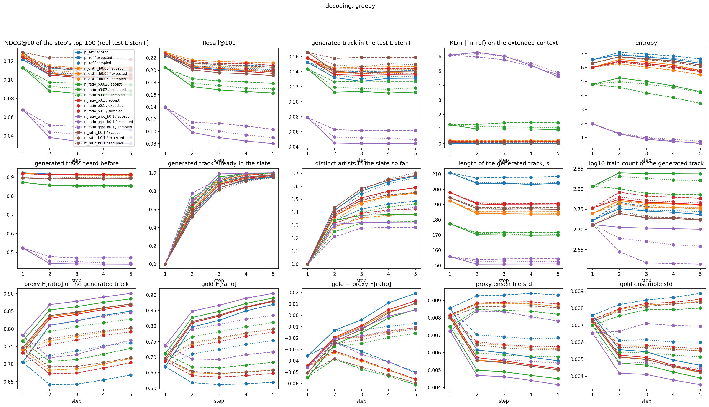{width=100%}

1. **Жадная генерация зацикливается у всех политик, включая π_ref.** Уже на шаге 2 жадный выбор в 52–68% случаев повторяет трек шага 1, к шагу 5 — в 95–100%: слейт из пяти позиций состоит из 1–2 треков. Модель выучила, что только что дослушанный трек слушают снова (в этих данных доминируют повторы), и 85–92% сгенерированных треков (кроме GRPO) — из истории. Это свойство next-item модели, а не RL. RL лишь ускоряет зацикливание пропорционально KL, реранкер зацикливается чуть медленнее π_ref. Сэмплирование убирает петли у политик рядом с π_ref (повтор в слейте 4–7%, 4.6–4.7 артиста из 5), но не у схлопнувшихся: GRPO (энтропия падает с 2.0 до 0.6–0.9) повторяется в 80–85% шагов даже при сэмплировании, RLOO β = 0.02 — в 19–31%.
2. **Релевантность падает с шагом у всех политик, сильнее всего на шаге 2.** У π_ref к шагу 5 — на 10–30% (0.122 → 0.110…0.086), того же порядка, что деградация Next-K в GPTRec. Хуже всего в `accept` и при сэмплировании, когда контекст заполняется треками, которые пользователь не выбирал, засчитанными как дослушанные. Меньше всего — в `expected`.
3. **Порядок политик сохраняется на каждом шаге:** реранкер ≥ `distill` ≥ RLOO β = 0.1 ≈ π_ref > RLOO β = 0.02 ≫ GRPO. RL при умеренном KL не деградирует быстрее π_ref: разница с π_ref на шаге 5 того же знака и порядка, что на шаге 1. Реранкер, пересчитываемый на каждом шаге, в режиме `expected` даже увеличивает отрыв (+0.008 на шаге 1, +0.012 / +0.016 на шаге 5), а в `accept` теряет его (+0.002 жадно, −0.002 сэмплированием): когда все сгенерированные треки считаются дослушанными, контекст перестаёт быть похожим на реальный, и оценки RM на нём ранжированию не помогают.
4. **KL не накапливается.** На расширенном контексте KL к π_ref остаётся на уровне шага 1 или падает: у RLOO β = 0.1 0.14 → 0.09–0.15, у GRPO 6.1 → 4.6–5.3. В петле обе модели согласны повторять трек. На своих траекториях за 5 шагов политики не расходятся с π_ref сильнее, чем на реальных контекстах.
5. **RM не сигнализируют о выходе из области данных, а поощряют петлю.** Proxy ratio сгенерированного трека с шагом растёт в `accept` (у π_ref 0.71 → 0.85) и `sampled` (→ 0.76) и не меняется в `expected`. Gold повторяет proxy и к шагу 5 обгоняет его (gold − proxy от −0.04 до +0.02), а разброс ансамбля *падает* (0.0086 → 0.0057): обе RM уверены, что повтор только что прослушанного трека будет дослушан. Симулятор на этих RM оценил бы зацикливание как лучшую сессию, и штраф за std ансамбля этого не поймает. Поэтому multi-step RL на собственных роллаутах (план 6.3) требует явного штрафа за повторы внутри сессии и проверки на реальных данных.
6. **Состав выдачи не дрейфует.** Длина и популярность сгенерированных треков остаются на уровне шага 1 (у RL-политик 170–190 с против 204–211 с у π_ref).

**Ответ на вопрос.** При генерации нескольких шагов проявляется прежде всего склонность next-item модели к повторам: петли и падение релевантности есть уже у π_ref. Умеренный RL не усиливает дрейф и не уводит политику дальше от π_ref, сильный (GRPO, KL 6) — схлопывается в повтор одного трека. RM-симулятор этот дефект не ловит, а поощряет.

## 5.5. Вопрос 5. Компромисс «релевантность ↔ награда»

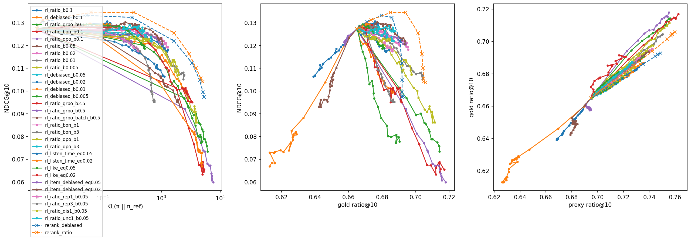{width=100%}

**Можно ли поднять награду без потери точности? Да, но только при малом KL, и лучше всего — без обучения:**

| Метод (val; test в скобках) | KL | NDCG@10 | Recall@100 | gold ratio | Длина, с |
|---|---|---|---|---|---|
| π_ref | 0 | 0.1274 (0.1216) | 0.228 | 0.665 | 207 |
| Реранкер R1 β = 0.1 | 0.08 | **0.1345 (0.1296)** | 0.227 | 0.685 | 194 |
| Реранкер R1 β = 0.05 | 0.34 | 0.1346 (0.1295) | 0.223 | 0.694 | 187 |
| Реранкер R4 β = 0.1 | 0.08 | 0.1332 (0.1297) | — | 0.680 | 212 |
| `distill` R1 β = 0.05 | 0.21 | 0.1321 (0.1265) | **0.235** | 0.683 | 193 |
| RLOO R1 β = 0.1 | 0.14 | 0.1294 (0.1244) | 0.232 | 0.678 | 196 |
| RLOO R1 β = 0.02 | 1.29 | 0.118 | — | 0.696 | 181 |

1. **Главный регулятор — KL, а не метод.** При равном KL RLOO, GRPO, BoN и DPO различаются на 0.001–0.003 NDCG, в пределах шума. Сравнивать методы «при одном β» нельзя.
2. **Переранжирование доминирует над всеми RL-политиками.** Оно повышает NDCG@10 на 6% (значимо на обоих днях), до уровня Repeat, и даёт больше gold-награды при меньшем KL. Реранкер вызывает RM на 100 кандидатах конкретного контекста и переставляет их; RL выучивает глобальные сдвиги (короче, меньше повторов) и тратит на них KL. Реранкер улучшает порядок головы выдачи, а не её состав: Recall@100 у него не растёт.
3. **Шум градиента — заметная часть разрыва RL.** Дистилляция того же целевого распределения без сэмплирования (`distill` ≡ `exact`) лучше RLOO при том же β (+0.0014…+0.005 NDCG; при β = 0.05 значимо с поправкой Holm на обоих днях, при β = 0.1 — не везде) и тратит вдвое-втрое меньше KL. Это лучшая обучаемая политика: +3–4% NDCG@10 и рост Recall@100, без RM на инференсе. До реранкера она не дотягивает (−0.003). На графике NDCG против gold она лежит на кривой реранкера, но не так далеко по ней, и даже на train-контекстах прошла лишь около 60% KL до цели.

**Проверка бюджета** (`distill` β = 0.05; `distill_budget*.png`, `bootstrap_distill_budget.csv`):

| Прогон | KL | NDCG@10 val (test) | Recall@100 | proxy | gold | KL к цели на train |
|---|---|---|---|---|---|---|
| 3 тыс. шагов, lr 5e-5 | 0.21 | 0.1321 (0.1265) | 0.235 | 0.721 | 0.683 | 0.150 |
| 10 тыс. шагов | 0.24 | 0.1322 (0.1245) | 0.234 | 0.724 | 0.685 | 0.126 |
| lr 2e-4 | 0.35 | 0.1281 (0.1229) | 0.230 | 0.725 | 0.686 | 0.191 |
| Реранкер β = 0.05 | 0.34 | 0.1346 (0.1295) | 0.223 | 0.742 | 0.694 | — |

Больший бюджет поднимает proxy и gold (+0.004 и +0.003, значимо), но не NDCG: при 10 тыс. шагов на val без изменений, на test −0.002 (p_holm = 0.01); при lr 2e-4 NDCG падает на 0.004 на обоих днях. KL к цели на train снижается медленно (0.150 → 0.126 при KL цели к π_ref ≈ 0.33), а lr 2e-4 при KL, равном реранкеру, подгоняет цель *хуже* (0.19) и тратит лишний KL на глобальный сдвиг. Значит, остаток разрыва (−0.002 NDCG на val, незначимо после поправки, −0.005 на test, −0.018 proxy к реранкеру) — не недообучение, а то, что одна модель (4 слоя, d = 256) не воспроизводит контекстно-зависимую перестановку top-100. Лучшая обучаемая политика остаётся `distill` 3 тыс. шагов.

4. **Функция награды определяет, *куда* уходит KL:**
   - **R2 (время)** — чистый взлом длиной: 207 → 494 с, NDCG 0.067, gold ratio ниже π_ref.
   - **R3 (лайк)** — переоптимизация [12] слабой головы: прирост proxy переходит в gold лишь на ≈25% (у ratio ≈80%).
   - **R4' (по треку)** продвигает треки с низкой нормой и снижает абсолютный ratio.
   - **R4 (по длине)** убирает смещение к коротким трекам при той же релевантности, что у R1: сырой gold ratio меняется на нормированный.
   - **Штрафы R5:** штраф за повтор переносит массу на нерелевантные новые треки (NDCG и `exclude_seen` падают). Штрафы за дизлайк и неопределённость нейтральны: голова дизлайка шумная, а разброс ансамбля не растёт.
   - **Штрафы за популярность и повтор артиста** — цели «за пределами точности», как в Petrov & Macdonald (2024) [7], но в виде слагаемых награды поверх RM (веса w ∈ {1, 3} в единицах std, см. ниже).
5. **Разнообразие и популярность** (`diversity_tradeoff.png`, `bootstrap_diversity.csv`; разницы к π_ref, val, все значимы при p_holm ≤ 0.006, если не указано иное):

   | Метод | KL | NDCG@10 | Разных артистов@10 | log10 популярности | coverage@10 | gold ratio |
   |---|---|---|---|---|---|---|
   | π_ref | 0 | 0.127 | 7.81 | 2.84 | 0.116 | 0.665 |
   | Реранкер R1 β = 0.1 | 0.08 | 0.135 | 7.72 | 2.83 | 0.116 | 0.685 |
   | Реранкер, артист w = 1, β = 0.1 | 0.34 | 0.116 | **9.36** | 2.86 | 0.108 | 0.685 |
   | Реранкер, артист w = 3, β = 0.1 | 0.52 | 0.109 | **9.75** | 2.88 | 0.105 | 0.684 |
   | RLOO, артист w = 1, β = 0.05 | 0.43 | 0.116 | 8.38 | 2.98 | 0.098 | 0.685 |
   | RLOO, артист w = 3, β = 0.05 | 0.59 | 0.107 | 8.73 | 3.05 | 0.086 | 0.685 |
   | Реранкер, популярность w = 1, β = 0.1 | 0.14 | 0.129 | 7.63 | **2.55** | 0.135 | 0.681 |
   | Реранкер, популярность w = 1, β = 0.05 | 0.61 | 0.122 | 7.67 | 2.43 | 0.140 | 0.687 |
   | RLOO, популярность w = 1, β = 0.05 | 0.75 | 0.118 | 7.50 | 2.38 | 0.141 | 0.678 |
   | RLOO, популярность w = 3, β = 0.05 | 2.54 | 0.077 | 7.96 | 1.69 | 0.135 | 0.668 |

   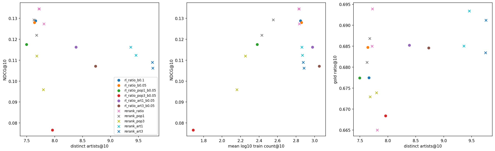{width=100%}

   - **Разнообразие артистов стоит релевантности.** Каждый дополнительный артист в top-10 обходится реранкеру в 0.011–0.014 NDCG; gold ratio не меняется. Повторы в этих данных — часто треки одного любимого артиста, и разнообразие их вытесняет.
   - **Реранкер снова лучше RL.** При одном и том же весе штрафа и β = 0.05 NDCG у них одинаков (разница незначима, p_holm ≥ 0.09), но реранкер даёт на 1.0–1.1 артиста больше и +0.007–0.008 gold. RL выполняет штраф «глобально»: сдвигается к более популярным трекам разных артистов (log10 популярности +0.10…+0.17 к RLOO без штрафа), и coverage падает до 0.086. Разнообразие *внутри* списка растёт ценой однообразия *между* пользователями — эффект, которого нет у реранкера.
   - **Популярность снижается почти бесплатно.** Реранкер с весом 1 при β = 0.1 уменьшает среднюю train-популярность выдачи в $10^{0.29} \approx 2$ раза, повышает coverage с 0.116 до 0.135 и не теряет NDCG относительно π_ref (+0.002, незначимо), хотя и уступает реранкеру без штрафа (−0.005). При β = 0.05 реранкер со штрафом лучше RLOO с тем же штрафом (+0.005 NDCG, +0.009 gold), а RLOO сильнее снижает популярность (log10 −0.05) — компромисс тот же, RL просто уходит по нему дальше. Но новые непопулярные треки не релевантнее: в режиме `exclude_seen` штраф за популярность снижает NDCG (RL: −0.006…−0.017).
6. **Gold RM не арбитр.** Она растёт вместе с proxy до KL 7.5, хотя NDCG падает вдвое и выдача укорачивается. Обе RM учились на одних логах и разделяют смещение к коротким трекам. Рост gold-награды необходим, но недостаточен: его нужно читать вместе с NDCG, режимом `exclude_seen` и составом выдачи.

## 5.6. Сопоставление с GPTRec (Petrov & Macdonald, 2024) [7]

Ближайшая работа — GPTRec с RL-дообучением под цели «за пределами точности». Совпадения и расхождения:

- **Двухэтапная схема.** В GPTRec сначала ученик учится повторять списки учителя (BERT4Rec [18] или марковская цепь) через CE, затем PPO выравнивает его с целевой метрикой. Наш `distill` — тот же первый этап, только учитель — реранкер π_ref·exp(r/β), то есть уже выровненная с наградой политика. Поэтому дистилляция у нас сама по себе даёт выровненную модель, и отдельный RL-этап после неё не нужен.
- **RL на точность почти ничего не даёт.** В GPTRec NDCG@10 после RL растёт на 0.4–2.6%, незначимо. У нас RLOO β = 0.1 даёт +1.6–2.3%, после поправки Holm значимо только на test. Обе работы приходят к одному: если цель — точность, достаточно хорошей обучаемой модели.
- **RL против переранжирования — противоположный результат, и это не противоречие.** В GPTRec RL лучше жадного переранжирования BERT4Rec (MMR, popularity rerank) в 3 из 4 случаев. Их цель листовая (ILD, NDCG с позиционным дисконтом), и жадная эвристика её не оптимизирует. У нас награда поточечная, и реранкер — точный оптимум той же KL-регуляризованной цели на top-100, так что обучаемая политика может к нему только приблизиться. Преимущество RL следует ожидать там, где награда зависит от всего списка и жадная сборка не оптимальна.
- **Next-K против Top-K.** GPTRec строит список по одному элементу с разделителем и позициями списка, у нас top-K берётся из одного распределения. Листовую цель (разнообразие артистов в слейте) мы проверили двумя шагами без смены модели; результаты — ниже. Next-K генерация с выученной листовой наградой (уровень 2) — §5.7.
- **Beyond-accuracy цели как слагаемые награды.** Как и в GPTRec, штрафы позволяют сдвинуть популярность и разнообразие ценой точности. В отличие от их результата, поточечный RL здесь уступает переранжированию и по этим целям: при равном NDCG реранкер даёт больше разных артистов и не жертвует разнообразием между пользователями.
- **Масштаб.** GPTRec ограничен каталогами < 4 тыс. объектов, у нас словарь из 200 тыс. треков, поэтому KL и softmax считаются по всему словарю, а реранкер — по top-100.
- **Метрики.** nPCOUNT@10 их статьи считается в `significance.py`. ILD по жанрам заменено числом разных артистов в top-10: жанров в Yambda нет, а аудио-эмбеддинги (13.8 ГБ) не использовались.

**Листовое разнообразие: жадный слейт и RL по спискам.** Два уровня:

- *уровень 0*, жадная сборка слейта без обучения (аналог MMR-бейзлайна GPTRec). Позиции 1–10 выбираются по очереди из top-100 π_ref по счёту реранкера log π_ref + (r − r̄)/β плюс λ/β, если артиста ещё нет в списке. Это жадная максимизация Σ[β log π_ref + r] + λ·(разные артисты). Число артистов субмодулярно, поэтому жадный список близок к лучшему;
- *уровень 1*, RL с наградой за список (`rl.method=slate`, β = 0.05, G = 8). Списки из 10 треков сэмплируются без возвращения по Plackett–Luce из одного softmax, награда — средняя RM-награда плюс λ·(разные артисты)/10, RLOO по спискам с точной логарифмической вероятностью списка. Политика не видит уже выбранные позиции и может менять только маргинальное распределение.

λ — ценность ещё одного артиста в единицах награды: λ = w·σ_ratio, w ∈ {0.5, 1, 2, 4, 8} для слейта и {0, 2, 8} для RL. Для жадного слейта KL в таблице — KL распределения реранкера, из top-100 которого собирается список. Сам слейт меняет только порядок первых позиций, поэтому Recall@100 у него тот же, что у реранкера. Цифры — val, разницы — парный бутстреп на val и test (`slate_rerank_val.csv`, `slate_tradeoff.png`, `bootstrap_slate.csv`):

| Метод | KL | NDCG@10 | Recall@100 | Артистов@10 | log10 попул. | gold ratio |
|---|---|---|---|---|---|---|
| π_ref | 0 | 0.127 | 0.228 | 7.81 | 2.84 | 0.665 |
| Реранкер β = 0.1 | 0.08 | 0.135 | 0.227 | 7.72 | 2.83 | 0.685 |
| Слейт β = 0.1, λ = 2σ | 0.08 | 0.133 | 0.227 | 9.02 | 2.85 | 0.685 |
| Слейт β = 0.1, λ = 8σ | 0.08 | 0.126 | 0.227 | 9.77 | 2.86 | 0.684 |
| Слейт β = 0.05, λ = 2σ | 0.34 | 0.132 | 0.223 | 9.38 | 2.85 | 0.694 |
| Слейт β = 0.05, λ = 8σ | 0.34 | 0.122 | 0.223 | 9.97 | 2.86 | 0.693 |
| Реранкер, артист w = 1, β = 0.1 | 0.34 | 0.116 | 0.224 | 9.36 | 2.86 | 0.685 |
| RLOO β = 0.05 | 0.41 | 0.128 | 0.228 | 7.64 | 2.86 | 0.685 |
| RLOO, артист w = 3, β = 0.05 | 0.59 | 0.107 | 0.217 | 8.73 | 3.05 | 0.685 |
| RL-слейт λ = 0 | 0.33 | 0.124 | 0.226 | 7.61 | 2.88 | 0.684 |
| RL-слейт λ = 2σ | 0.30 | 0.124 | 0.227 | 8.01 | 2.89 | 0.684 |
| RL-слейт λ = 8σ | 0.34 | 0.121 | 0.221 | 8.66 | 2.93 | 0.683 |

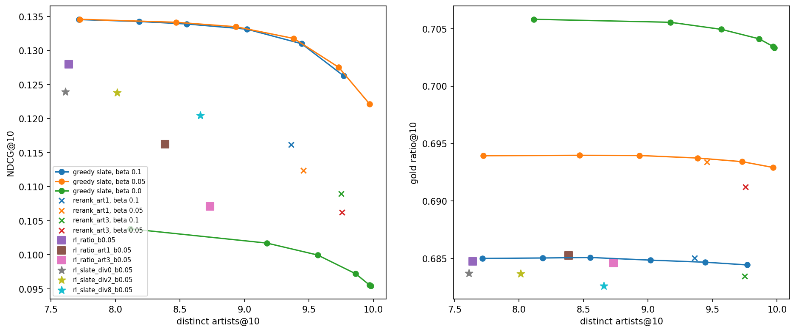{width=100%}

1. **Жадный слейт делает разнообразие почти бесплатным.** При β = 0.1 и λ = 2σ он добавляет 1.3 артиста в top-10 ценой −0.0014 / −0.0012 NDCG@10 к реранкеру без бонуса (val / test, p_holm 0.017 / 0.029) и остаётся на +0.006 / +0.007 выше π_ref (p_holm 0.004). Gold ratio не меняется (−0.0002…−0.0003). Первые дополнительные артисты стоят ≈ 0.001 NDCG каждый против 0.011–0.014 у поточечного штрафа (§5.5, п. 5). Дорожает только у предела в 10 артистов: λ = 8σ даёт +2.0–2.2 артиста за −0.007…−0.012 NDCG.
2. **Почему поточечный штраф дорог.** Он меняет всё распределение: штрафует каждый трек частого артиста, включая первый и те, что за пределами top-10. Поэтому растёт KL и падает Recall@100 (0.227 → 0.224…0.202). Слейт вытесняет только второй и следующие треки артиста из первых позиций. При близком числе артистов слейт β = 0.05, λ = 8σ лучше реранкера с поточечным штрафом w = 3 при том же β: +0.016 / +0.017 NDCG, +0.021 Recall@100, +0.2 артиста, +0.002 gold при KL 0.34 против 1.05.
3. **RL по спискам без бонуса хуже обычного RLOO.** При λ = 0 и том же β NDCG ниже на 0.004 / 0.005 (p_holm 0.004) при меньшем KL (0.33 против 0.41) и почти том же gold (−0.001). NDCG падает уже с ≈ 250 шагов, когда у RLOO он ещё растёт (`slate.png`). Вероятная причина: награда списка — среднее по 10 позициям, и градиент Plackett–Luce раздаёт кредит всему списку, а не его голове, которую измеряет NDCG. Кроме того, усреднение по 10 трекам сжимает разброс наград между списками.
4. **Как способ получить разнообразие в RL листовая награда лучше поточечного штрафа.** RL-слейт λ = 8σ и RLOO со штрафом w = 3 дают почти одинаковое число артистов (8.66 и 8.73), но у слейта NDCG выше на 0.013 / 0.012, KL 0.34 против 0.59, меньше сдвиг к популярным трекам (log10 2.93 против 3.05, nPCOUNT@10 −0.015) и выше coverage@10 (0.100 против 0.086). Награда за список поощряет разных артистов *внутри* одного списка, поэтому политике не нужно уходить к глобально популярным трекам разных артистов, как при поточечном штрафе (§5.5, п. 5).
5. **Но RL уровня 1 не догоняет жадный слейт.** При том же λ и β = 0.05 у жадного слейта на 1.3–1.4 артиста больше и gold выше на 0.010 (p_holm 0.004), а NDCG не ниже: +0.008 / +0.011 при λ = 2σ (p_holm 0.004) и +0.002 / +0.004 при λ = 8σ (на val незначимо, на test p_holm 0.029). При равном числе артистов (≈ 8.7) разрыв по NDCG ≈ 0.013. Политика без доступа к уже выбранным позициям может только поднять маргинальную массу треков разных артистов, а согласовать позиции между собой, как жадная сборка, не может. Поэтому разнообразие, которое она реализует, намного меньше того, что «покупает» награда.
6. **Якорь π_ref нужен и здесь.** Жадная сборка при β = 0 (только r + λ) даёт максимальный gold (0.706), но NDCG 0.104 при любом λ.

**Ответ.** Для ручной субмодулярной листовой цели вывод §7 сохраняется: жадная сборка в инференсе — почти точный оптимум, она дешевле и лучше RL. RL уровня 1 полезен только в сравнении с поточечным RL-штрафом. Преимущество обучения возможно там, где выученная листовая награда несубмодулярна и жадная сборка перестаёт быть оптимальной; эта постановка (RM слейта и Next-K) — §5.7.

## 5.7. Выученная RM слейта и Next-K генерация (уровень 2)

В §5.6 листовая цель была ручной и субмодулярной. Здесь листовая награда выучивается из логов, а список строится по одному элементу, как в GPTRec [17]. Код — `slate_rm.py` и `nextk.py`, запуск — `06_slate_rl.ipynb`, результаты — `results/nextk`.

**Слейт в логах.** В Яндекс Музыке рекомендации идут потоком, поэтому слейт здесь — серия подряд идущих рекомендаций (`is_organic = 0`) в одной сессии, нарезанная на куски до 10 треков. Контекст — всё, что было до первого трека серии. За val-день таких серий 14 тыс. (≈ 100 тыс. прослушиваний, средняя длина ≈ 7), за test-день — 15 тыс.

**RM слейта.** Отклик на позицию j предсказывается по контексту и трекам позиций 1…j, но без отклика на позиции < j: это то, что известно, когда список выдаётся целиком. Устройство: к замороженной поточечной RM добавлен причинный трансформер из двух слоёв по последовательности [состояние контекста, c₁, …, c_L], и его поправка прибавляется к логитам поточечных голов:

$$\text{logits}_j = \text{heads}(h, c_j) + \Delta(z_j).$$

Поправка Δ инициализирована нулём, поэтому на шаге 0 RM слейта совпадает с поточечной, и выигрыш над ней — это вклад списка. Proxy строится поверх proxy RM, gold — поверх gold RM на 80% пользователей и с другим сидом. Награда списка — средний ожидаемый ratio по 10 позициям.

**Политика Next-K.** GPT-2 выбирает позицию j из π(· | контекст, a₁, …, a_{j−1}). Выбранные треки дописываются в контекст как рекомендации с train-средним бином доли прослушивания трека (входа «отклик неизвестен» у модели нет), повторы внутри списка маскируются. Обучение — RLOO по 8 спискам на контекст с наградой proxy RM слейта. KL к Next-K π_ref суммируется по позициям, обе политики перенормированы на ещё не выбранные треки. Вариант Top-K строит список из одного softmax (Plackett–Luce, как уровень 1). β задаётся в единицах внутригрупповой std награды списка под π_ref.

**Бейзлайны без обучения:**

- π_ref в режимах Top-K и Next-K и поточечный реранкер R1 β = 0.1;
- пошаговый поиск по RM слейта: a_j = argmax log π_ref(a | s_j) + (r_j(a | a_{<j}) − r̄)/β по top-100 π_ref(· | s_j). Это пошаговый реранкер, который не учитывает, как выбор позиции влияет на следующие; RL это учитывает;
- Best-of-16: лучший по proxy RM слейта из 16 списков, сэмплированных из π_ref.

**Листовые эффекты в логах** (`list_effects.csv`, val; test так же):

- **позиция почти не влияет:** средняя доля прослушивания 0.72–0.74 на позициях 1–10;
- **повтор артиста внутри серии — сильный, но редкий эффект:** доля 0.43–0.61 против 0.72–0.74, если артист уже был выше в той же серии. Таких позиций 1.5–4.5%: продовый рекомендатель повторов избегает. Отрыв убывает к концу серии (−0.30 на позициях 2–6, −0.12 на позиции 10). Связь наблюдательная: повтор мог выбираться после скипов.

**Качество RM слейта** на сериях val-дня (test в скобках; `slate_rm_quality.csv`). Поточечная RM оценивает каждую позицию отдельно по тому же состоянию контекста:

| Метрика | RM слейта, proxy | Поточечная, proxy | RM слейта, gold | Поточечная, gold |
|---|---|---|---|---|
| loss | 1.343 (1.344) | 1.392 (1.386) | 1.333 (1.338) | 1.391 (1.387) |
| ratio: MAE | 0.214 (0.215) | 0.218 (0.218) | 0.214 (0.215) | 0.214 (0.214) |
| ratio: Spearman | 0.587 (0.593) | 0.591 (0.597) | 0.593 (0.597) | 0.592 (0.600) |
| Listen+: AUC | 0.878 (0.880) | 0.869 (0.872) | 0.880 (0.881) | 0.870 (0.873) |
| skip: AUC | 0.877 (0.880) | 0.867 (0.871) | 0.880 (0.881) | 0.869 (0.873) |
| continue: AUC | 0.668 (0.680) | 0.603 (0.614) | 0.665 (0.676) | 0.599 (0.611) |
| Spearman награды списка | 0.737 (0.742) | 0.734 (0.741) | 0.742 (0.748) | 0.736 (0.745) |

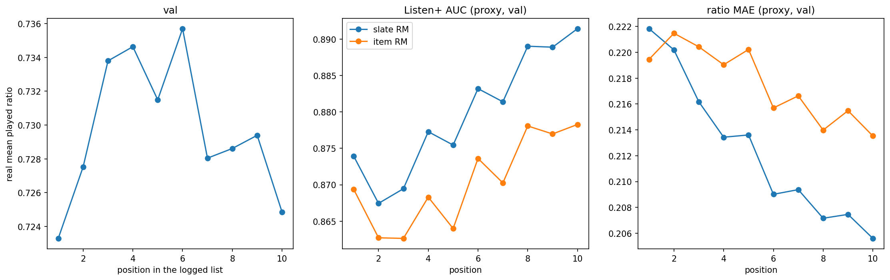{width=100%}

- **Листовой сигнал есть.** RM слейта лучше по loss (−3.5%), AUC Listen+ и skip (+0.01) и MAE, а выигрыш растёт с позицией: прирост AUC Listen+ +0.005 на позициях 1–2 и +0.013 на позиции 10. На позиции 1 предыдущих треков нет, так что часть выигрыша — донастройка на рекомендательных сериях; рост к концу серии — вклад самого списка. Proxy и gold согласуются.
- **Скачок `continue` (0.60 → 0.67) — в основном отбор.** Позиция j в логах существует, только если пользователь до неё дошёл, и модель выучила, что дальше в серии сидят вовлечённые пользователи. Награда для сгенерированного списка поэтому означает ожидаемую долю *при условии, что пользователь дошёл до позиции*.
- **Ранжирование списков почти не меняется.** Spearman по ratio даже чуть ниже (0.587 против 0.591), Spearman награды списка с реальным средним ratio серии — 0.737 против 0.734. RM слейта лучше калибрована по позициям, но упорядочивает списки почти так же, как поточечная. Пространство для выигрыша RL над переранжированием поэтому узкое, а единственный сильный листовой эффект — повтор артиста — субмодулярен, и с такими целями справляется жадная сборка (§5.6).

**RL и сравнение со списками без обучения** (`nextk_comparison.csv`, `nextk_trajectories.png`, `bootstrap_nextk.csv`). RL Next-K обучен при β = 1.15σ и 0.5σ, Top-K — при 1.15σ: 2000 шагов, батч 32 контекста × 8 списков. Оценка — жадные списки на 3000 пользователей val и test, награда списка — RM слейта. `kl_ref` — KL списка к π_ref того же режима, суммированный по позициям; для поиска и реранкера он не считался. NDCG@10 и награды даны как val (test):

| Метод | NDCG@10 | gold, список | proxy, список | KL | артистов в топ-10 | повторов в топ-10 |
|---|---|---|---|---|---|---|
| π_ref Top-K | 0.1209 (0.1227) | 0.689 (0.688) | 0.722 (0.721) | 0 | 7.5 | 0.80 |
| π_ref Next-K | 0.1180 (0.1147) | 0.690 (0.689) | 0.717 (0.714) | 0 | 6.8 | 0.77 |
| RL Top-K, 1.15σ | 0.1221 (0.1233) | 0.701 (0.700) | 0.738 (0.737) | 0.55 | 7.5 | 0.81 |
| RL Next-K, 1.15σ | 0.1175 (0.1160) | 0.707 (0.707) | 0.741 (0.740) | 0.51 | 6.7 | 0.77 |
| RL Next-K, 0.5σ | 0.1030 (0.1013) | 0.746 (0.747) | 0.781 (0.781) | 2.21 | 6.8 | 0.69 |
| поиск, β = 0.1 | 0.1258 (0.1225) | 0.721 (0.722) | 0.770 (0.770) | — | 6.6 | 0.76 |
| поиск, β = 0.05 | 0.1253 (0.1217) | 0.739 (0.740) | 0.799 (0.799) | — | 6.6 | 0.73 |
| поиск, β = 0 | 0.0793 (0.0751) | 0.773 (0.773) | 0.847 (0.846) | — | 7.6 | 0.53 |
| Best-of-16 | 0.0590 (0.0582) | 0.718 (0.720) | 0.750 (0.750) | — | 9.1 | 0.48 |
| реранкер R1, β = 0.1 | 0.1345 (0.1296) | 0.717 (0.717) | 0.760 (0.759) | — | 7.7 | 0.83 |
| `distill`, β = 0.05 | 0.1267 (0.1266) | 0.709 (0.709) | 0.748 (0.747) | 1.43 | 7.5 | 0.81 |
| RLOO R1, β = 0.05 | 0.1248 (0.1237) | 0.713 (0.713) | 0.756 (0.756) | 3.32 | 7.4 | 0.80 |

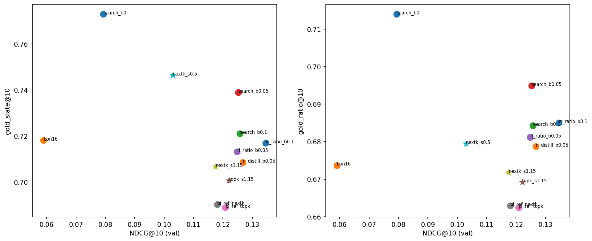{width=100%}

Парный бутстрап по пользователям (с поправкой Холма) даёт на val и test одни и те же выводы:

- **Next-K π_ref уступает Top-K по NDCG** (−0.003 на val, −0.008 на test), как в GPTRec. Дописанные треки уводят следующие позиции к тому же артисту: в списке 6.8 артистов против 7.5, так модель продолжает реальные серии. По награде списка режимы равны.
- **RL оптимизирует награду, и gold идёт за proxy.** Next-K при 1.15σ поднимает gold-награду списка на +0.017 при KL 0.5 и NDCG без значимых изменений (−0.001 / +0.001, p ≈ 0.6). При 0.5σ gold растёт на +0.056, а NDCG падает на −0.015. Переоптимизации в этом диапазоне нет: gold прибавляет 70–88% прироста proxy. Средняя награда на train растёт медленно (0.663 → 0.669 при 1.15σ, 0.667 → 0.692 при 0.5σ), а на val KL продолжает расти до конца 2000 шагов.
- **Условность на предыдущие позиции почти ничего не даёт.** Next-K при том же β и KL выигрывает у Top-K +0.006 gold, но проигрывает −0.005 / −0.007 NDCG, и всё это — из-за более низкого NDCG самого Next-K π_ref.
- **Пошаговый поиск доминирует RL.** Поиск при β = 0.1 даёт над Next-K π_ref +0.008 NDCG и +0.031 gold, то есть RL при 1.15σ хуже его по обоим. RL при 0.5σ выше по gold (+0.025), но на −0.021 NDCG; поиск при β = 0.05 имеет почти тот же gold (0.739 против 0.746) при NDCG 0.125 против 0.103. На графике обе RL-точки лежат ниже кривой поиска (β = 0.1 → 0.05 → 0). Учёт влияния позиции на следующие, ради которого и нужен RL по списку, не перекрывает неполной амортизации поиска одной моделью, как и у поточечного RL против реранкера (§5.5).
- **Best-of-16 бесполезен** для релевантности: сэмплированные списки новые и разнообразные (9 артистов, 48% повторов против 77–80%), и NDCG падает вдвое при gold не выше, чем у поиска при β = 0.1.
- **Поточечные методы не хуже листового RL даже по листовой награде.** Реранкер R1 β = 0.1, обученный по поточечной proxy RM, выигрывает у RL Next-K при 1.15σ +0.017 NDCG и +0.010 gold-награды списка, `distill` — +0.009 NDCG и +0.002 gold. Пошаговый поиск по RM слейта при β = 0.1 даёт над реранкером лишь +0.004 gold при −0.009 NDCG (val): как и следовало из качества RM слейта, листовая награда упорядочивает кандидатов почти так же, как поточечная.

Итог: выученная RM слейта сама по себе корректна (gold согласуется с proxy, RL её оптимизирует без взлома), но в логах Yambda нет сильного несубмодулярного листового эффекта, который RL мог бы извлечь сверх пошагового поиска. Профит от RL по списку здесь не получен. Лучшее в этой постановке — реранкер по поточечной RM для NDCG или пошаговый поиск по RM слейта, если важнее листовая награда.

# 6. Off-policy ветка

REINFORCE с многошаговой коррекцией (Matveev et al., 2026) [8], адаптированный под GPT-2. Эта ветка не использует RM: награда берётся прямо из логов.

- **Траектория** — серия подряд идущих рекомендаций в сессии. Награда — реальная из логов: like + ratio/10. Дисконт γ = 0.9.
- **Вес** — $\min(c, \prod_K \pi_\theta/\hat\pi_b)$ по K = 10 шагам, c = 0.5. Нормировка по сумме весов, без бейзлайна, без KL — как в статье.
- **Поведенческая политика $\hat\pi_b$** — базовая модель, дообученная одну эпоху на следующих *рекомендованных* треках.
- **Абляции:** K = 1 (коррекция Chen et al., 2019 [19]), K = 0 (без коррекции), награда = ratio вместо like + ratio/10, вариант с KL β = 0.05 к π_ref. 16 окон на шаг, lr 1e-4, 3000 шагов.
- **Оценка** — та же релевантность и RM-метрики, плюс офлайн-оценки Step-IS [20] и SNIPS [21] реальной награды на рекомендациях val/test.

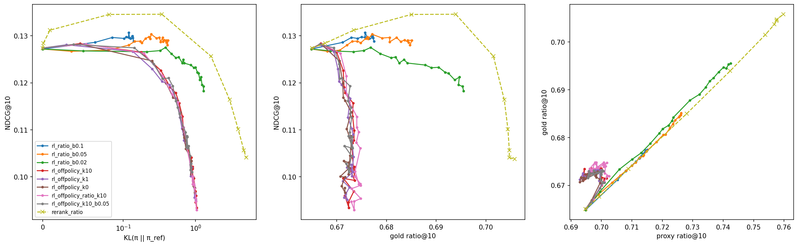{width=100%}

**Результаты** (val; test совпадает; все разницы с π_ref значимы, p_holm ≤ 0.003):

| Политика | KL | NDCG@10 | Recall@100 | Повторы@10 | Энтропия | log10 популярности | coverage@10 | gold ratio |
|---|---|---|---|---|---|---|---|---|
| π_ref | 0 | 0.127 | 0.228 | 0.85 | 6.5 | 2.84 | 0.115 | 0.665 |
| RLOO R1 β = 0.1 | 0.14 | 0.129 | 0.231 | 0.85 | 5.9 | 2.85 | 0.115 | 0.677 |
| Off-policy, K = 10 | 1.01 | 0.096 | 0.200 | 0.79 | 7.6 | 2.96 | 0.077 | 0.672 |
| Off-policy, K = 1 | 0.99 | 0.096 | 0.202 | 0.79 | 7.6 | 2.97 | 0.080 | 0.672 |
| Off-policy, K = 0 | 0.97 | 0.098 | 0.203 | 0.80 | 7.6 | 2.95 | 0.083 | 0.672 |
| Off-policy, награда ratio | 1.01 | 0.095 | 0.199 | 0.80 | 7.6 | 2.99 | 0.077 | 0.673 |
| Off-policy, K = 10, KL β = 0.05 | 0.86 | 0.103 | 0.210 | 0.80 | 7.5 | 2.97 | 0.081 | 0.672 |

1. **Политика учится подражать продовому рекомендателю, а не пользователю.** Все варианты уходят на KL ≈ 1 и теряют 0.025–0.033 NDCG@10 (−19…−26%). Энтропия *растёт* (6.5 → 7.6), выдача становится популярнее, а coverage падает. Без бейзлайна и с положительной наградой (like + ratio/10 ≥ 0) градиент повышает вероятность *любой* залогированной рекомендации, взвешенно по награде. Залогированные рекомендации — это не то, что пользователь слушает дальше (в основном повторы), поэтому политика уходит от поведенческой релевантности. Награда почти не влияет на результат: like + ratio/10 и ratio дают одно и то же.
2. **Многошаговая коррекция ничего не меняет.** K = 10, K = 1 и K = 0 различаются на ≤ 0.002 NDCG. При c = 0.5 обрезается 50% (K = 10) – 90% (K = 1) весов. После нормировки на сумму весов это почти равные веса, то есть фактически K = 0. KL к π_ref (β = 0.05) лишь замедляет уход (KL 0.86, NDCG 0.103).
3. **RM этих сдвигов не видит.** Proxy ratio не меняется (0.695 → 0.694), gold растёт на 0.007 — меньше, чем у RLOO R1 при KL 0.14.
4. **Офлайн-оценка IS неинформативна.** Step-IS (клип 10) оценивает off-policy политики на +46…+57% выше $\hat\pi_b$ (0.52–0.55 против 0.35 для like + ratio/10), а RM-политики — ниже $\hat\pi_b$ (RLOO β = 0.1: 0.33; GRPO с KL 6: 0.02). Но рост одинаков для обеих наград (примерно в 1.5 раза и для like + ratio/10, и для ratio): оценка измеряет, насколько политика повышает вероятность залогированных действий, а не их качество. SNIPS вырожден: эффективный размер выборки ≤ 0.02% действий, и оценка одна и та же (≈ 0.42) почти для всех политик; для π_ref на val — 0.04. При 200 тыс. треков и оценённой $\hat\pi_b$ веса траекторий из 5–10 шагов неуправляемы. DM / DR [22] статьи требуют модели отклика для роллаутов и не реализованы.

**Вывод.** В нашей постановке (словарь 200 тыс., $\hat\pi_b$ оценена по логам, бюджет 3000 шагов по 16 окон) off-policy ветка не даёт полезной политики и не поддаётся надёжной офлайн-оценке. Статья работает в другом режиме: свой продовый рекомендатель (известная π_b), онлайн-A/B для проверки и на порядки больший бюджет. Отличие от RM-ветки показательно: обучаясь на реальной награде, но только на действиях, которые выбирал чужой рекомендатель, политика учит его распределение. RM-ветка оценивает любые кандидаты (ценой экстраполяции) и остаётся рядом с π_ref.

# 7. Вывод: полезен ли RL для обучения рекомендательной модели

**В нашей постановке RL как способ обучения почти бесполезен, но цель, которую он оптимизирует, полезна. Реализовать её лучше без RL.**

**Что говорит за RL.**

- **Награда действительно растёт.** Proxy и gold растут синхронно, переоптимизации до KL 7.5 нет (§5.1).
- **Лучшая RL-политика даёт небольшой прирост точности.** У RLOO при β = 0.1 NDCG@10 выше на 2%, но после поправки Holm прирост значим только на test (§5.2). Так же и в GPTRec: RL с наградой за точность даёт малый и ненадёжный прирост.

**Что говорит против.**

- **RL находит дешёвые пути.** Выдача становится короче, в ней меньше повторов, она уже. Чем дальше политика уходит от π_ref, тем ниже NDCG: 0.127 → 0.08 при KL 4 (§5.1–5.2).
- **Выбор алгоритма не важен.** RLOO, GRPO, BoN и онлайн-DPO при равном KL неразличимы. Ограничение не в алгоритме, а в обучении по сэмплированному градиенту.
- **Без обучения получается лучше.** Реранкер π_ref·exp(r/β) — точный оптимум той же цели на top-100 — даёт +6% NDCG@10, больше gold-награды и меньший KL (§5.5).
- **Дистилляция реранкера лучше RL.** Обычная CE к целевому распределению без сэмплирования даёт +3–4% NDCG при вдвое меньшем KL. Значит, заметная часть разрыва — шум оценки градиента. Увеличение бюджета разрыв с реранкером не закрывает.
- **Листовая цель тоже решается без обучения.** Жадный слейт даёт +1.3 артиста за −0.0013 NDCG; RL по Plackett–Luce спискам при том же λ получает меньше артистов, ниже gold и не выше NDCG (§5.6).
- **Выученная листовая награда тоже.** RL с Next-K генерацией против RM слейта, обученной на реальных сериях, растит gold-награду списка, но пошаговый поиск по той же RM лучше и по награде, и по NDCG; поточечный реранкер не хуже листового RL даже по листовой награде (§5.7).
- **Off-policy RL на логах без RM** учит подражать продовому рекомендателю (§6).
- **Долгосрочный прокси p(continue) как награда не работает.** Внутри пользователя он не связан ни с длиной сессии, ни с возвращением, а его оптимизация идёт через короткие и популярные треки (§5.3).

**Почему так.** Награда поточечная: каждый трек оценивается отдельно. Для такой награды KL-регуляризованный оптимум имеет закрытую форму, и его можно посчитать в инференсе. Обучаемой политике остаётся только амортизировать этот оптимум. Вместо перестановок кандидатов внутри контекста она выучивает глобальные сдвиги (длину, новизну) и тратит на них KL.

**Где RL может быть оправдан** — там, где закрытого оптимума нет:

- награда зависит от всего списка и несубмодулярна: выученная RM слейта, позиционные эффекты. Для ручного разнообразия жадная сборка уже достаточна (§5.6). Выученная из логов RM слейта (§5.7) ранжирует списки почти как поточечная, единственный сильный листовой эффект в логах субмодулярен, и RL с Next-K пошаговый поиск не обогнал. Нужна награда с настоящим несубмодулярным эффектом, например исход всей серии;
- многошаговая цель на уровне сессии с честной обратной связью, а не с RM-симулятором, который поощряет петли (§5.4);
- онлайн-обучение с известной поведенческой политикой и A/B-проверкой, как в Matveev et al. [8];
- инференс не может позволить вызов RM на сотне кандидатов. Тогда амортизация нужна, но через дистилляцию, а не через policy gradient.

**Оговорки.**

- Офлайн-метрика поведенческая: Listen+ при продовой политике — в основном повторы, поэтому новые треки, которые продвигает RM, оценить нельзя.
- Gold-RM учится на тех же логах и разделяет их смещения.
- Окончательно полезность проверяется только онлайн.

**Итог.** Награду из RM стоит использовать, но через переранжирование или его дистилляцию. RL оправдан, когда награда листовая или многошаговая и закрытого оптимума нет.

# 8. Ограничения

- **Обезличенные данные.** Качественный анализ возможен только через артистов, длину, популярность и пересечение с историей.
- **RM знает только реально прослушанные треки.** Для остальных она экстраполирует. Proxy и gold учились на одних логах, поэтому gold не ловит общие смещения.
- **Офлайн-оценка поведенческая.** Listen+ на следующем дне отражает то, что пользователь слушал при продовой политике, и в основном это повторы. Рекомендации, которые пользователь не видел, оценить нельзя.
- **Long-term-выводы наблюдательные.** Причинный эффект требует A/B.
- **Симулятор отклика в роллаутах — та же proxy RM**, которой оцениваются политики; релевантность шагов меряется по реальным Listen+ дня, но не по реакции на сгенерированные треки.
- **Ограниченный бюджет.** 3000 шагов RL (дистилляция — до 10 тыс.), RM — одна эпоха; off-policy ветка обучена существенно меньше, чем в статье, а её поведенческая политика — оценка по логам, а не настоящая продовая π_b. Модель — GPT-2 на ID треков, а не two-tower.
- **Серии рекомендаций в логах адаптивны и отобраны.** Продовый рекомендатель менял следующий трек после скипа, а поздние позиции серии есть только у тех, кто до них дошёл. RM слейта учит отклик на показанные серии, а не на произвольный список, и смешивает листовые эффекты с вовлечённостью.
- **Недетерминизм GPU.** Одна и та же π_ref в разных сессиях даёт NDCG 0.1272 и 0.1274. Поэтому все выводы опираются на парный бутстреп и два независимых дня.

# 9. Направления дальнейшей работы

- Амортизация реранкера: больший бюджет дистилляции, дистилляция с контекстно-зависимыми признаками, политика с отдельной «головой переранжирования».
- Multi-step RL на собственных роллаутах с дисконтированной наградой (план 6.3) — только с явным штрафом за повторы внутри сессии: RM оценивают петли высоко, а разброс ансамбля на них падает (§5.4).
- Онлайн-проверка: A/B реранкера против π_ref с метриками сессий и возвращаемости.

**Листовая награда.** Все наши R1–R6 поточечные: RM оценивает трек, не зная, что ещё попало в выдачу. Листовая награда R(s, [a₁, …, a_K]) оценивает список целиком, и ценность трека зависит от соседей. Примеры: разнообразие (второй трек того же артиста ценится меньше), насыщение похожими треками, позиционные эффекты, квоты на новизну и популярность, исход всего списка (продолжение сессии после слейта). По §7 именно здесь RL может обойти переранжирование. Шаги по возрастанию сложности:

- **Ручные листовые слагаемые при той же RM.** Так устроен эксперимент §5.6: средняя RM-награда плюс λ · (разные артисты)/10, жадный слейт (уровень 0) и RL по Plackett–Luce спискам (уровень 1). Другие ручные слагаемые (квоты новизны и популярности, лимит повторов) добавляются так же. Если цель субмодулярна, жадная сборка близка к оптимальной, и обучение не нужно — та же ситуация, что с реранкером для поточечной награды. Для разнообразия артистов §5.6 это подтвердил.
- **Текущая RM, применённая последовательно.** Трек k оценивается на контексте, к которому дописаны треки 1…k−1 с симулированным откликом. Такая оценка ловит насыщение и повторы, но, как показал §5.4, высоко оценивает петли и экстраполирует. Без явного штрафа за повторы внутри сессии она непригодна.
- **Отдельная RM слейта на логах и Next-K генерация.** Первая версия сделана в §5.7: RM по позициям серии поверх поточечной RM и RLOO по Next-K спискам. Что дальше: таргет — исход всей серии (продолжение сессии после неё, лайки), а не средний ratio по позициям; поправка на отбор поздних позиций (их видят только дошедшие пользователи); регуляризация к залогированному распределению и штраф за неопределённость, потому что списков намного больше, чем треков, и RM слейта экстраполирует сильнее поточечной; PPO с критиком для отложенной награды за серию. Содержательное преимущество у обучения перед переранжированием появляется, только если выученная награда несубмодулярна, а в наших логах заметен лишь субмодулярный эффект повтора артиста.
- **Чего на Yambda не сделать.** Модель слейта с позиционным смещением (каскадная модель, клики с учётом позиции) требует показов, а в Yambda видно только прослушанное, не показанное и пропущенное. Рекомендации там идут потоком, а не списком на экране, поэтому «слейт» здесь — это серия треков в сессии.

Порядок действий: RL уровня 1 в §5.6 жадный слейт не догнал, что подтверждает вывод §7 для ручных листовых целей. Выученная RM слейта (§5.7) нашла листовой сигнал, но слабый для ранжирования списков. RL с Next-K пошаговый поиск по ней не обогнал, поэтому следующий шаг — исход серии как таргет и онлайн-проверка, а не больший RL-бюджет.

# 10. Воспроизведение

Код — `src/recsys_rl`, ноутбуки для Colab — `notebooks/00`–`06` (соответствие этапам в `notebooks/README.md`). Таблицы и графики — `results/stage2`–`results/stage6` и `results/nextk`. Инструкции по установке и запуску — в `README.md`.

# Литература

1. Radford A., Wu J., Child R. et al. Language Models are Unsupervised Multitask Learners. OpenAI Technical Report, 2019.
2. Ploshkin A. et al. Yambda-5B — A Large-Scale Multi-modal Dataset for Ranking and Retrieval. arXiv:2505.22238, 2025.
3. Kang W.-C., McAuley J. Self-Attentive Sequential Recommendation. ICDM, 2018.
4. Ahmadian A. et al. Back to Basics: Revisiting REINFORCE-Style Optimization for Learning from Human Feedback in LLMs. ACL, 2024.
5. Shao Z. et al. DeepSeekMath: Pushing the Limits of Mathematical Reasoning in Open Language Models. arXiv:2402.03300, 2024.
6. Rafailov R. et al. Direct Preference Optimization: Your Language Model is Secretly a Reward Model. NeurIPS, 2023.
7. Petrov A. V., Macdonald C. Aligning GPTRec with Beyond-Accuracy Goals with Reinforcement Learning. arXiv:2403.04875, 2024.
8. Matveev et al. Session-Level Optimization for Large-Scale Retrieval using REINFORCE with Multi-Step Off-Policy Correction. arXiv:2607.02818, 2026.
9. Efron B., Tibshirani R. J. An Introduction to the Bootstrap. Chapman & Hall, 1993.
10. Holm S. A Simple Sequentially Rejective Multiple Test Procedure. Scandinavian Journal of Statistics, 6(2), 1979.
11. Yi X. et al. Sampling-Bias-Corrected Neural Modeling for Large Corpus Item Recommendations. RecSys, 2019.
12. Gao L., Schulman J., Hilton J. Scaling Laws for Reward Model Overoptimization. ICML, 2023 (arXiv:2210.10760).
13. Williams R. J. Simple Statistical Gradient-Following Algorithms for Connectionist Reinforcement Learning. Machine Learning, 8, 1992.
14. Plackett R. L. The Analysis of Permutations. Journal of the Royal Statistical Society, Series C, 24(2), 1975.
15. Schulman J. et al. Proximal Policy Optimization Algorithms. arXiv:1707.06347, 2017.
16. Schulman J. et al. High-Dimensional Continuous Control Using Generalized Advantage Estimation. ICLR, 2016.
17. Petrov A. V., Macdonald C. Generative Sequential Recommendation with GPTRec. Gen-IR Workshop at SIGIR, 2023 (arXiv:2306.11114).
18. Sun F. et al. BERT4Rec: Sequential Recommendation with Bidirectional Encoder Representations from Transformer. CIKM, 2019.
19. Chen M. et al. Top-K Off-Policy Correction for a REINFORCE Recommender System. WSDM, 2019.
20. Precup D., Sutton R. S., Singh S. Eligibility Traces for Off-Policy Policy Evaluation. ICML, 2000.
21. Swaminathan A., Joachims T. The Self-Normalized Estimator for Counterfactual Learning. NeurIPS, 2015.
22. Jiang N., Li L. Doubly Robust Off-policy Value Evaluation for Reinforcement Learning. ICML, 2016.
